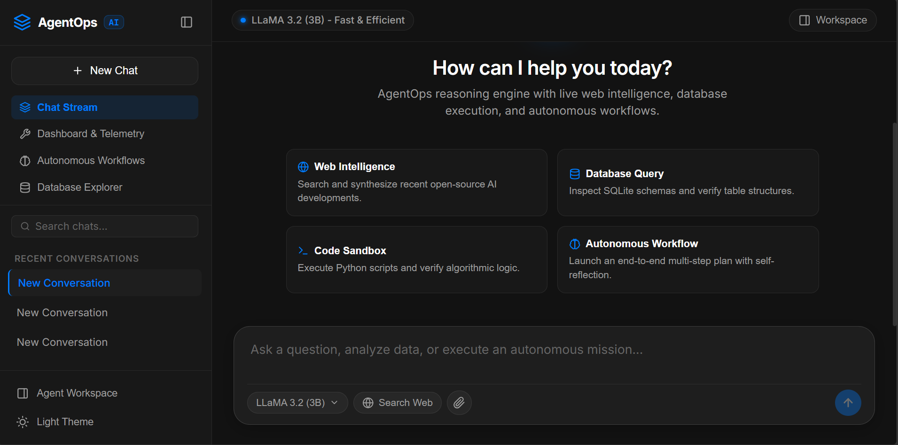
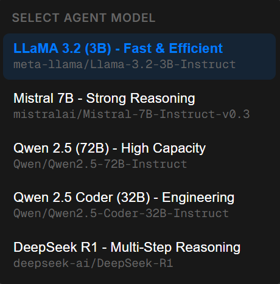

# AgentOps

### Autonomous AI Agent Platform with Open-Weight Intelligence

AgentOps is an enterprise-grade agentic AI platform designed for multi-step reasoning, autonomous workflows, dynamic tool execution, and vector memory management. Built with a minimalist dark interface inspired by Kimi AI, AgentOps provides seamless access to open-weight models including LLaMA 3.2, Mistral 7B, Qwen 2.5 Coder, and DeepSeek R1 via modular model adapters.

---

## User Interface & System Visuals

### 1. Conversational Interface & Shell
The primary workspace utilizes a precision dark theme (`#121212` background, white typography, `#007CFF` electric-blue accents, and Inter/Geist Mono typography) featuring a collapsible session sidebar, quick prompt action chips, and a rounded prompt composer.



### 2. Modular Model Adapter Dropdown
Users can switch between top-tier open-weight models in real time through the modular model adapter interface. Supported engines include LLaMA 3.2 (3B), Mistral 7B, Qwen 2.5 (72B), Qwen 2.5 Coder (32B), and DeepSeek R1.



---

## Architecture

```text
+-----------------------------------------------------------------------------+
|                             Next.js 14 Frontend                             |
|       (Chat UI | Telemetry Dashboard | Workflows | Swarm | Memory | SQL)     |
+--------------------------------------|--------------------------------------+
                                       | Server-Sent Events (SSE) / REST
+--------------------------------------v--------------------------------------+
|                       Python Backend (Flask / FastAPI)                      |
+--------------------------------------+--------------------------------------+
| Modular Model Adapters               | Memory Architecture                  |
| - Hugging Face Serverless Router     | - Short-Term Sliding Buffer          |
| - OpenAI & Anthropic Adapters        | - Vector Database (MiniLM-L6-v2)     |
| - Offline Local Fallback Adapter     | - Relational Conversation Store      |
+--------------------------------------+--------------------------------------+
| Action & Execution Tools             | Multi-Agent Orchestration            |
| - REST API Caller Tool               | - Collaborative Agent Swarm          |
| - Web Scraper & DuckDuckGo Search    | - Multi-Stage Autonomous Workflows   |
| - SQLite Query & Schema Tool         | - BLIP Vision Analysis               |
| - Python Sandboxed Code Runner       | - Whisper Speech-to-Text             |
+-----------------------------------------------------------------------------+
```

---

## Key Capabilities

### Minimalist Kimi AI-Inspired Design
- **Theme Palette**: Deep `#121212` canvas, elevated `#181818` surfaces, `#007CFF` electric-blue action triggers, and subtle 1px border dividers.
- **Typography**: Inter for crisp interface legibility and Geist Mono for code blocks and JSON payloads.
- **Collapsible Sidebar**: Real-time conversation search, thread management, view switching, and light/dark theme toggles.
- **Rounded Prompt Composer**: Kimi-style rounded composer with model selector pill, file upload attachments, and live web search toggle.
- **Zero Emojis**: 100% clean vector SVG icons for all visual controls, status indicators, and badges.

### Modular Model Adapters
- **ModelAdapterFactory**: Extensible provider pattern decoupling backend logic from upstream AI APIs.
- **Providers Supported**:
  - `HuggingFaceAdapter`: Direct integration with the Hugging Face Serverless Router (`https://router.huggingface.co/v1`).
  - `OpenAIAdapter`: Compatible with standard OpenAI API endpoints.
  - `LocalFallbackAdapter`: Self-contained offline reasoning engine.

### Autonomous Tools & Actions
- **Web Intelligence**: Real-time web scraping and search parsing via BeautifulSoup and DuckDuckGo.
- **API Caller**: Dynamic HTTP client supporting GET, POST, PUT, DELETE with configurable headers and payloads.
- **Database Operations**: Schema inspection and SQL query execution over SQLite and PostgreSQL databases.
- **Code Execution Sandbox**: Secure Python script execution for algorithms, data formatting, and mathematical operations.

### Dual Memory Architecture
- **Short-Term Memory**: Token-budgeted sliding window context buffer.
- **Long-Term Memory**: Local vector store using Sentence Transformers (`sentence-transformers/all-MiniLM-L6-v2`) with cosine similarity retrieval.

---

## Directory Structure

```text
agentops-main/
|-- backend/
|   |-- app/
|   |   |-- adapters/         # Modular LLM adapters (Hugging Face, OpenAI, Local)
|   |   |-- agents/           # Multi-agent swarm definitions
|   |   |-- intelligence/     # Prompts, personas, ReAct reasoning engine
|   |   |-- memory/           # Sliding context buffer and vector store
|   |   |-- routes/           # FastAPI routers
|   |   |-- services/         # Master coordinator, voice, vision
|   |   |-- tools/            # Web search, scraper, API caller, DB, sandbox
|   |   |-- config.py         # Backend configuration settings
|   |   |-- database.py       # SQLAlchemy engine and session factory
|   |   |-- models.py         # Relational database models
|   |-- app_flask.py          # Python Flask server with modular adapters
|-- frontend/
|   |-- app/                  # Next.js 14 layout and page routes
|   |-- components/           # UI components (ChatInterface, Composer, Workspace, Sidebar)
|   |-- lib/                  # API client, types, constants
|   |-- styles/               # CSS modules and design tokens
|   |-- package.json          # Node dependencies
|-- img/
|   |-- output1.png           # Main conversational interface
|   |-- op2.png               # Modular model selector dropdown
|   |-- op3.png               # Agent workspace and execution telemetry
|-- .env.example              # Environment variables template
|-- .gitignore                # Git ignore patterns
|-- docker-compose.yml        # Multi-container orchestration
`-- README.md                 # Project documentation
```

---

## Quick Start

### 1. Environment Configuration

Copy the example environment file:
```bash
cp .env.example .env
```

Configure environment values in `.env`:
```ini
# Hugging Face Access Token (optional if using local fallback)
HF_TOKEN=your_token_here
HF_ROUTER_BASE_URL=https://router.huggingface.co/v1
HF_DEFAULT_MODEL=meta-llama/Llama-3.2-3B-Instruct

# Database and Storage
DATABASE_URL=sqlite:///./ai_agent.db
VECTOR_STORE_PATH=./vector_store.json

# Server Parameters
HOST=0.0.0.0
PORT=8000
```

### 2. Backend Execution

Install Python dependencies:
```bash
cd backend
pip install -r requirements.txt
```

Launch the Flask server with Modular Model Adapters:
```bash
python app_flask.py
```

*Alternatively, launch the FastAPI server:*
```bash
python -m uvicorn app.main:app --host 0.0.0.0 --port 8000 --reload
```

### 3. Frontend Execution

From the `frontend` directory:
```bash
cd frontend
npm install
npm run dev
```

Open your browser at `http://localhost:3000`.

---

## API Endpoints Reference

| Method | Endpoint | Description |
|---|---|---|
| `POST` | `/api/chat/send` | Synchronous message execution with ReAct reasoning and tool invocation |
| `POST` | `/api/chat/stream` | Server-Sent Events (SSE) token and step-by-step reasoning stream |
| `GET` | `/api/conversations/` | List all stored conversation threads |
| `POST` | `/api/conversations/create` | Initialize a new conversation thread |
| `DELETE` | `/api/conversations/<id>` | Delete a conversation thread and associated history |
| `GET` | `/api/tools/` | List all registered tools and their parameter specifications |
| `POST` | `/api/tools/execute` | Directly invoke a tool with custom parameters |
| `GET` | `/api/memory/` | Query vector memory entries using cosine similarity |
| `POST` | `/api/memory/add` | Ingest a new document into vector memory |
| `POST` | `/api/workflows/execute` | Execute an autonomous multi-phase workflow |

---

## License

This project is licensed under the MIT License.
